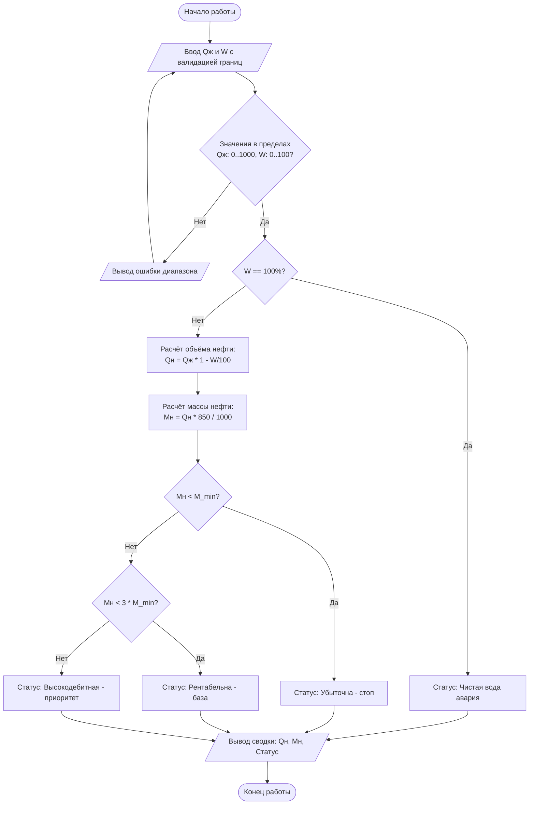

# Отчет по практической работе №1 — Системный анализ и декомпозиция

Мы выполняли эту работу в паре на базовой траектории (Вариант А).
Роли распределили так:
* Системный аналитик (СА): Студент 1 (№2 по журналу)
* Ведущий разработчик (Dev): Студент 2 (№5 по журналу)

Номер нашего варианта посчитали по формуле N = N1 + N2:
N = 2 + 5 = 7

---

## 1. Исходные данные для нашего варианта (N = 7)

По формулам из методички мы получили следующие контрольные цифры:
* Контрольный дебит жидкости (Qж) = 50 + 3 * (7 % 25) = 71.0 м3/сут
* Контрольная обводненность (W) = 15 + 2 * (7 % 35) = 29.0%
* Порог рентабельности по нефти (M_min) = 8.0 + 0.5 * (7 % 10) = 11.5 т/сут
* Стандартная плотность нефти из задания = 850 кг/м3

---

## 2. Результаты ручного расчета (Прогноз Аналитика)

Чтобы проверить, правильно ли пишет код разработчик, я заранее посчитал все показатели вручную на листочке:
1. Расчет объема нефти: 71.0 * (1 - 29 / 100) = 71.0 * 0.71 = 50.41 м3/сут.
2. Расчет массы нефти: (50.41 * 850) / 1000 = 42.85 т/сут.
3. Проверка статуса прибыли: Наш минимальный порог M_min равен 11.5 т/сут. Тройной порог для приоритетных скважин равен 11.5 * 3 = 34.5 т/сут. Наша расчетная масса 42.85 т/сут оказалась больше, чем 34.5. 
* Итоговый прогноз статуса: скважина должна получить статус "Высокодебитная (приоритет)".

---

## 3. Функциональная декомпозиция (на какие части разбили программу)

Большую монолитную задачу мы разделили на 4 маленькие и независимые функции:
1. read_valid_param(prompt, min_val, max_val) — отвечает за безопасный ввод данных оператором. Крутится в цикле, пока человек не введет нормальное число. Защищает от букв, пустоты и минусов, а также сама меняет запятые на точки.
2. calc_oil_volume(q_liq, w_pct) — берет общую жидкость и процент воды, после чего по формуле находит чистый объем нефти в кубах.
3. calc_oil_mass(q_oil, density) — переводит кубические метры нефти в тонны, используя плотность 850 кг/м3.
4. evaluate_profitability(m_oil, w_pct, m_min) — финальная бизнес-логика. Сравнивает тонны нефти с порогами и вешает статус рентабельности.
* ВАЖНАЯ ПРАВКА (Упражнение №4): По требованию заказчика, если обводненность (W) равна ровно 100%, функция должна мгновенно вернуть статус "Чистая вода (авария)" и не тратить ресурсы на расчет массы и проверку порогов.

---

## 4. Блок-схема нашего алгоритма (Mermaid)

---

## 5. Трассировка схемы по шагам (Сухой прогон для Упражнения 3)

Если запустить наши индивидуальные числа (Qж = 71.0, W = 29.0) по стрелочкам на схеме, получается следующий путь:
Начало -> Ввод данных -> Данные в пределах нормы? (Да) -> Обводненность равна 100%? (Нет, у нас 29) -> Расчет объема нефти -> Расчет массы нефти -> Масса меньше 11.5? (Нет, у нас 42.85) -> Масса меньше 34.5? (Нет) -> Присвоение статуса "Высокодебитная" -> Вывод сводки на экран -> Конец работы.
